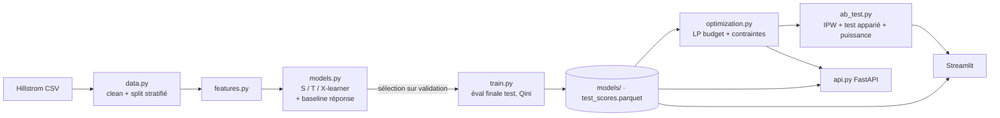

# 📈 Uplift Budget Optimizer

Pipeline de data science **de bout en bout** : à qui envoyer une campagne marketing pour maximiser le **profit incrémental** sous contrainte de budget ?

**Causal ML (uplift) → optimisation (PuLP/CBC) → validation statistique (IPW, test apparié, puissance) → API FastAPI → dashboard Streamlit → Docker.**
100 % open source, aucune clé API. Dataset : [Hillstrom Email Marketing](http://www.minethatdata.com) (test randomisé, 64 000 clients, 2 emails vs contrôle).

---

## Résultats en bref

| Question | Réponse | Niveau de preuve |
|---|---|---|
| La randomisation tient-elle ? | **Oui** : \|SMD\| max = 0,014 (seuil 0,1), AUC de prédiction du groupe = 0,496 | Solide |
| Les emails marchent-ils ? | **Oui**, tous deux. Conversion 0,57 % (contrôle) → 0,88 % (Womens, **+0,31 pt**) et 1,25 % (Mens, **+0,68 pt**), p < 0,001 après correction de Holm | Solide |
| L'effet varie-t-il selon les clients ? | **Faiblement** : effet positif presque partout, seule piste : Womens plus efficace chez les clientes `womens = 1` | Faible (IC qui se recouvrent) |
| L'uplift modeling bat-il un modèle de réponse ? | **Non démontré** : sur le test, le modèle de réponse (Qini moyen 0,00027) fait aussi bien que le T-learner retenu (0,00025) | Écarts dans le bruit |
| La politique optimisée bat-elle le ciblage aléatoire ? | **Oui, de justesse** : +0,08 € par client (IC 95 % [+0,009 ; +0,150], p = 0,027) à budget égal | Moyen (borne basse proche de 0) |
| Bat-elle le top-uplift naïf ? | **Non** : écart nul, les deux politiques contactent les mêmes clients | Quasi-identité |
| Faut-il un test live ? | **Oui** : ≈ 18 000 clients par groupe pour confirmer le gain du ciblage | — |

> **Ce qu'il faut retenir** : l'essentiel de la valeur vient **de l'email lui-même** (ATE +0,68 pt pour Mens), pas du **choix des destinataires**. Le ciblage apporte un gain modeste, positif mais incertain, car la conversion est un événement rare (≈ 1 %, 578 conversions au total).

---

## Pourquoi l'uplift et pas un score de propension ?

Un modèle de réponse cible ceux qui achèteront le plus… dont beaucoup achèteraient **sans** la campagne (budget gaspillé), voire se désabonnent. L'uplift estime l'effet **additionnel** du contact sur chaque client :

$$\tau(x) = P(y=1 \mid x,\ \text{contacté}) - P(y=1 \mid x,\ \text{non contacté})$$

| Type de client | Sans email | Avec email | Intérêt de l'envoi |
|---|---|---|---|
| **Persuadables** | ne convertit pas | convertit | ✅ la vraie cible |
| **Acquis** | convertit | convertit | ❌ coût inutile |
| **Perdus** | ne convertit pas | ne convertit pas | ❌ coût inutile |
| **Réfractaires** | convertit | ne convertit pas | ❌ l'email nuit |

Le test `test_uplift_beats_response_model_when_responders_are_not_persuadable` démontre l'avantage de l'uplift sur un cas contrôlé (données synthétiques). **Sur Hillstrom, cet avantage n'est pas démontré** (voir plus bas) : l'effet y est quasi homogène, un modèle de réponse capte déjà presque tout le signal.

---

## Démarche : recherche (notebooks) → production (scripts)

| Notebook (prototype / hypothèses) | Ce qu'on y établit | Industrialisé dans |
|---|---|---|
| `01_eda.ipynb` | randomisation valide (SMD, AUC ≈ 0,5), ATE + IC, hétérogénéité de l'effet, contraintes de l'événement rare | `data.py` (split stratifié traitement × outcome), `features.py` |
| `02_modeling_prototype.ipynb` | H1 uplift vs réponse · H2 S/T/X-learner sur validation · H3 sensibilité hyperparamètres (3 graines) · prototype == package (assert) | `models.py`, `evaluation.py`, `train.py` |
| `03_optimization_prototype.ipynb` | gain vs budget (LP / glouton / aléatoire) · quand le LP bat vraiment le glouton (coûts distincts + capacité) | `optimization.py`, `run_optimization.py` |
| `04_ab_test_prototype.ipynb` | puissance, MDE, estimation IPW sans biais, test apparié, incertitude vs taille d'échantillon | `ab_test.py` |

Les notebooks sont aussi des **tests d'intégration** : `make test-nb` les exécute de bout en bout (assertions incluses).

---

## Choix du modèle

### Les candidats

| Modèle | Principe | Risque principal |
|---|---|---|
| **S-learner** | un seul modèle, le traitement est une colonne ; uplift = $\hat\mu(x,1)-\hat\mu(x,0)$ | la colonne traitement est ignorée (arbres peu profonds, effet faible) : uplift écrasé vers 0 |
| **T-learner** | deux modèles (traités / contrôle) ; uplift = $\hat\mu_1(x)-\hat\mu_0(x)$ | variance élevée : différence de deux estimations bruitées |
| **X-learner** | T-learner + imputation des effets individuels, pondérée par la propension | complexité, peu de gain sans effet hétérogène fort |
| **Modèle de réponse** (baseline) | prédit $P(y=1 \mid x)$ chez les traités, sans notion d'effet | cible les « acquis » plutôt que les « persuadables » |

Tous utilisent un `HistGradientBoosting` **volontairement régularisé** : `max_depth` faible, `min_samples_leaf = 100`, `l2_regularization = 1`. Avec ≈ 1 % de conversions, un modèle flexible ajuste le bruit : le notebook 02 (H3) le confirme, le Qini diminue quand la profondeur augmente (≈ 0,00055 à profondeur 2, ≈ 0,00027 à profondeur 4).

### Procédure de sélection

1. Les learners sont comparés sur la **validation** (Qini moyen sur les deux bras).
2. Le meilleur learner d'uplift est **ré-entraîné** puis évalué **une seule fois** sur le test.
3. On ne change pas de modèle après avoir vu le test (sinon fuite d'information).

**Learner retenu : `t_learner`** (Qini moyen validation = 0,00031, contre 0,00008 pour le S-learner et 0,00001 pour le X-learner).

### Résultats sur la validation et sur le test

| Modèle | Qini moyen validation | Qini moyen **test** | uplift@30 % test Mens | uplift@30 % test Womens |
|---|---|---|---|---|
| S-learner | 0,00008 | **0,00050** | +0,97 pt | +0,74 pt |
| T-learner (retenu) | 0,00031 | 0,00025 | **+1,17 pt** | +0,73 pt |
| X-learner | 0,00001 | 0,00012 | +0,75 pt | +0,42 pt |
| Modèle de réponse | 0,00040 | 0,00027 | +0,87 pt | +0,63 pt |

*Référence : l'effet moyen (ATE) est de +0,68 pt (Mens) et +0,31 pt (Womens).*

### Lecture honnête

- **Le classement change entre validation et test** : le S-learner passe de dernier à premier, le T-learner de premier à troisième. C'est le signe que **les écarts entre learners sont du même ordre que le bruit** (≈ 0,0001 à 0,0002), et non que l'un d'eux est meilleur.
- Tous les Qini moyens du test sont **positifs**, et l'uplift@30 % dépasse l'ATE pour tous les modèles : le classement contient probablement **un signal modeste**.
- L'ordre de grandeur est faible : un Qini de 0,0003 correspond à ≈ +0,03 pt de conversion incrémentale par client, contre +0,68 pt pour l'effet de l'email Mens.
- Sur le top 30 % (≈ 3 800 clients, ≈ 20 conversions par groupe), l'erreur standard de l'uplift observé est d'environ 0,3 pt (IC ≈ ±0,6 pt) : un uplift@30 de +1,17 pt n'est **pas** statistiquement distinguable de l'ATE (+0,68 pt).
- Le T-learner est conservé parce que le **protocole** le désigne, pas parce qu'il est démontré meilleur.

### Ce que montrent les courbes de Qini (test)

- **Toutes les courbes se terminent au même point** : l'envoi à tous donne ≈ 43 conversions incrémentales (Mens) et ≈ 20 (Womens), soit l'ATE × effectif. Seule la **forme** de la courbe dépend du modèle.
- **Womens** : presque toutes les courbes sont **au-dessus de la diagonale** (ciblage au hasard) sur l'ensemble de la plage : le classement apporte un gain.
- **Mens** : résultat plus mitigé. Le S-learner reste au-dessus de la diagonale, le T-learner passe sous la diagonale entre 50 % et 90 % de la population, le X-learner est **sous la diagonale** presque partout.
- Une courbe qui **dépasse son point final** (S-learner en Womens, autour de 85 %) indique que les derniers clients du classement ont un effet nul ou négatif, ou que c'est du bruit. Les courbes sont très « en escalier » : chaque saut est une conversion.

### Ce qu'on peut défendre

> Les emails ont un effet causal clair. Le ciblage par uplift apporte au mieux un gain modeste, non prouvé de façon robuste sur Hillstrom, et aucun learner n'est clairement supérieur à un modèle de réponse. Le T-learner régularisé est retenu par protocole, pour sa simplicité, sa stabilité relative et son interprétabilité (un modèle par groupe).

---

## Pourquoi ces formules : ce qu'elles calculent, indiquent et montrent

L'idée commune : on ne peut **jamais observer l'effet pour un même client** (il reçoit l'email *ou* non). Toutes les métriques contournent ce problème en comparant des **groupes** que la randomisation rend équivalents.

### 1. Effet moyen, intervalle de confiance et tests (notebook 01)

| Calcul | Formule | Ce qu'il indique |
|---|---|---|
| **ATE** | $\hat p_a - \hat p_c$ | Gain absolu de conversion (points). Causal car les groupes sont comparables au départ |
| **Erreur standard** | $SE=\sqrt{\frac{s_a^2}{n_a}+\frac{s_c^2}{n_c}}$ | Précision de l'estimation (diminue en $1/\sqrt n$) |
| **IC 95 %** | $\widehat{ATE}\pm1{,}96\,SE$ | Fourchette plausible de l'effet ; s'il exclut 0, l'effet est significatif |
| **Test z de 2 proportions** | $z=\frac{\hat p_a-\hat p_c}{\sqrt{\hat p(1-\hat p)(\frac1{n_a}+\frac1{n_c})}}$ | Distance à $H_0$ en nombre d'écarts-types (variance **poolée** : sous $H_0$ les deux groupes ont le même taux) |
| **Lift relatif + IC** | ratio $\hat p_a/\hat p_c$, IC sur le **log** (méthode delta) | Gain en %, avec un IC asymétrique et toujours > −100 % |
| **Holm** | p-values ajustées pour $m$ tests | Évite les faux positifs quand on teste plusieurs bras |

**Ce que ça montre ici** : Mens +0,68 pt (+119 %), Womens +0,31 pt (+54 %), significatifs après correction. Il faut toujours reporter l'ATE absolu avec le lift relatif : +119 % correspond à moins d'un point de conversion.

### 2. Contrôle de la randomisation

| Calcul | Formule | Ce qu'il indique |
|---|---|---|
| **SMD** | $\frac{\bar x_T-\bar x_C}{\sqrt{(s_T^2+s_C^2)/2}}$ | Écart standardisé par variable, **indépendant de la taille d'échantillon** (une p-value ne l'est pas). Seuil usuel : \|SMD\| < 0,1 |
| **AUC du classifieur de groupe** | AUC d'une régression logistique prédisant le traitement | Équilibre **conjoint** (interactions comprises) ; ≈ 0,5 = les features ne permettent pas de deviner le groupe |

**Ce que ça montre ici** : \|SMD\| max = 0,014 et AUC = 0,496 : les groupes sont comparables, donc l'ATE et l'IPW sont interprétables causalement. Ce contrôle ne couvre que les variables **observées**.

### 3. Évaluation des modèles d'uplift (`evaluation.py`)

On ne peut pas calculer une erreur par client. On **trie** les clients par uplift prédit, puis on vérifie, en groupe, si le haut du classement réagit vraiment plus.

| Calcul | Formule | Ce qu'il indique |
|---|---|---|
| **Courbe de Qini** | $Q(k)=Y_T(k)-Y_C(k)\cdot\frac{N_T(k)}{N_C(k)}$ | Conversions **incrémentales** cumulées quand on ne contacte que les $k$ premiers. Le ratio $N_T/N_C$ remet le contrôle à l'échelle des traités |
| **Coefficient de Qini** | $\frac1n\int_0^1\bigl(Q(x)-Q(1)\,x\bigr)dx$ | Aire entre la courbe et la diagonale aléatoire. > 0 : mieux que le hasard, ≈ 0 : inutile, < 0 : pire. Unité : taux de conversion incrémental moyen par client |
| **uplift@k** | $\bar y_{\text{traités}}-\bar y_{\text{contrôle}}$ sur le top $k$ % | Gain observé en ciblant seulement les $k$ % les plus prometteurs, la métrique la plus parlante pour le métier |
| **Déciles / quintiles** | uplift observé vs prédit par tranche | **Monotonie** (le gain décroît du haut vers le bas) et **calibration** (prédit ≈ observé) |

**Pourquoi pas l'AUC ROC ?** L'AUC mesure qui **convertit**, le Qini mesure qui convertit **grâce à l'email**. Ce sont deux populations différentes (acquis vs persuadables).

**Ce que ça montre ici** : classement légèrement meilleur que le hasard, calibration correcte en moyenne (uplift prédit moyen ≈ ATE), mais non monotone par quintile et très bruité (≈ 10 conversions chez les traités par quintile).

### 4. Optimisation du budget (`optimization.py`)

Pour chaque client $i$ et action $k$ (email Hommes, Femmes) :

$$g_{ik}=\text{uplift}_{ik}\times v - c_k \qquad\qquad \max\sum_{i,k} g_{ik}\,x_{ik}$$

sous : un seul email par client ($\sum_k x_{ik}\le1$), budget total ($\sum c_k x_{ik}\le B$), capacités par bras et nombre de contacts maximal (optionnels). C'est un **sac à dos à choix multiple** résolu par PuLP/CBC.

- **Idée** : le budget couple toutes les décisions (un client choisi consomme un budget qui n'ira pas à un autre). Un simple tri ne sait pas arbitrer entre « un gros gain très cher » et « deux petits gains bon marché ».
- **Élagage** : un couple à gain net ≤ 0 n'est jamais choisi, on ne crée pas de variable pour lui.
- **Ce que ça montre ici** : avec un seul budget et des coûts identiques par bras, **trier par gain net est déjà optimal**. Le LP rejoint donc le top-uplift naïf. Il ne devient utile qu'avec des **coûts distincts par bras**, des **plafonds** ou un **budget non saturé**.

### 5. Validation sans biais d'une politique : IPW (`ab_test.py`)

Les scores d'uplift servent à **décider**, pas à **valider** : l'optimiseur choisit justement les clients dont l'uplift est surestimé (biais du vainqueur). On valide donc avec les **résultats observés**, grâce à la randomisation :

$$\hat V(\pi)=\frac1n\sum_{i=1}^n\frac{\mathbf 1[T_i=\pi(x_i)]}{e(\pi(x_i))}\,y_i,\qquad e(a)=P(T=a)$$

- **Idée** : on garde les clients dont l'action reçue $T_i$ coïncide avec celle que la politique $\pi$ aurait choisie, et chacun compte pour $1/e$ clients pour remplacer ceux qui n'ont pas coïncidé.
- **Pourquoi sans biais** : $\mathbb E\bigl[\frac{\mathbf 1[T=\pi(x)]Y}{e}\mid x\bigr]=\frac{e\cdot\mathbb E[Y(\pi(x))\mid x]}{e}=\mathbb E[Y(\pi(x))\mid x]$.
- **Profit** : $\text{profit}_i=v\cdot t_i-c_{\pi(x_i)}$, où le coût est compté pour **tous** les clients ciblés.
- **Limite** : seuls ≈ 1/3 des clients contribuent (ceux qui « matchent »), et avec ≈ 1 % de conversion la variance est élevée : les IC sont larges.

### 6. Comparer deux politiques : test apparié

$$d_i=t_i^B-t_i^A,\qquad z=\frac{\bar d}{s_d/\sqrt n},\qquad IC_{95\%}=\bar d\pm1{,}96\,\frac{s_d}{\sqrt n}$$

- **Pourquoi apparié** : A et B sont évaluées sur les **mêmes clients**. Quand elles choisissent la même action, $d_i=0$ : ces clients n'ajoutent aucun bruit. Seuls ceux où les politiques **diffèrent** comptent.
- **Ce que ça montre ici** : optimisée vs aléatoire = **+0,08 € par client** (IC [+0,009 ; +0,150], p = 0,027) ; optimisée vs naïve = **écart nul** (p = 0,32, soit $z = 1$ pour **un seul** client qui diffère). Ce n'est pas un manque de puissance, c'est une quasi-identité des deux politiques.
- Avec la correction de Holm sur ces deux comparaisons, le premier p passe à ≈ 0,053 : le résultat est **à la limite** de la significativité.

### 7. Puissance, MDE et taille d'échantillon

$$h=2\arcsin\sqrt{p_1}-2\arcsin\sqrt{p_2},\qquad n_{\text{par groupe}}=\frac{2\,(z_{1-\alpha/2}+z_{\text{puissance}})^2}{h^2}\approx\frac{15{,}7}{h^2}$$

($\alpha=5\,\%$, puissance 80 %). La transformation en arcsinus stabilise la variance d'une proportion.

| Écart à détecter (taux de base 0,58 %) | Clients par groupe |
|---|---|
| +1 pt | ≈ 1 600 |
| +0,5 pt | ≈ 5 000 |
| +0,3 pt | ≈ 12 500 |
| +0,2 pt | ≈ 26 000 |
| +0,1 pt | ≈ 98 000 |

- **Idée** : $n$ varie en $1/h^2$ (diviser l'écart par 2 multiplie $n$ par 4). `min_detectable_effect` inverse la relation : quel est le plus petit écart détectable avec $n$ clients ?
- **Ce que ça montre ici** : les effets des emails sont détectables facilement. Le **gain du ciblage** (+0,27 pt de conversion vs aléatoire) demande ≈ 18 000 clients par groupe en test live, soit plus que le jeu de test disponible. D'où des conclusions prudentes.
- L'analyse par sous-échantillonnage (25 % → 100 % du test) confirme que l'incertitude décroît en $1/\sqrt n$ et que le résultat est **à la limite de la puissance** (la différence n'est significative que dans 30 à 60 % des tirages intermédiaires).

---

## Améliorations envisagées

### Modélisation
- **Robustesse de la sélection** : remplacer le simple split de validation par une **validation croisée répétée** (plusieurs graines), car le classement des learners s'inverse entre validation et test.
- **IC par bootstrap** sur le Qini et l'uplift@k, avec la distribution du Qini d'un **score aléatoire** en référence.
- **Learners plus robustes** : R-learner, DR-learner (doublement robuste), causal forest, ou **moyenne de plusieurs learners** (S + T + réponse) pour réduire la variance.
- **Tester l'hétérogénéité** par un test d'interaction (traitement × variable) plutôt que par le recouvrement des IC.

### Mesure de la valeur
- **Utiliser `spend` comme résultat** (Hillstrom contient la dépense) au lieu d'une valeur fixe par conversion : le profit devient mesuré, pas supposé.
- **Évaluation doublement robuste (AIPW)** à la place de l'IPW simple : même absence de biais, variance plus faible, donc des IC plus étroits.
- **Analyse de sensibilité** sur `value_per_conversion`, `cost_per_contact` et `budget` (hypothèses métier, non fournies par Hillstrom).

### Optimisation
- Introduire des **coûts distincts par bras**, des **plafonds** et des contraintes de fréquence pour que le LP justifie sa valeur face au glouton.
- Intégrer l'**incertitude de l'uplift** (par exemple viser une borne basse prudente) pour limiter le biais du vainqueur.

### Validation et données
- **Test live** d'environ 18 000 clients par groupe, avec un plan d'analyse défini à l'avance (politique figée avant le test).
- **Jeu de données plus grand** (par exemple Criteo Uplift) pour retrouver de la puissance sur l'hétérogénéité.
- Effets de **fatigue**, de **valeur vie client** et de **désabonnement**, absents de Hillstrom.

---

## Architecture


## Démarrage rapide
```bash
python -m venv .venv && source .venv/bin/activate
make install            # dépendances
make data               # télécharge Hillstrom (data/raw/)
make all                # train + optimize + report  -> reports/RESULTS.md
make app                # dashboard  http://localhost:8501
make reproduce          # tout rejouer dans l'ordre : notebooks exécutés (sorties enregistrées), tests, pipeline, rapport
make api                # API        http://localhost:8000/docs
```
Hors-ligne / CI : `UPLIFT_SYNTHETIC=1` génère des données synthétiques au même schéma (**tests uniquement**, jamais pour publier des résultats).

## Résultats détaillés
Les chiffres de ce README proviennent de `reports/metrics.json` (Qini et uplift@30 % par modèle, validation et test), des notebooks 01 à 04 et de `reports/RESULTS.md` (généré par `python -m uplift.report`). Après une nouvelle exécution, **regénérer ces fichiers et mettre à jour les tableaux** : aucun chiffre ne doit être saisi à la main sans source.

## Configuration business (`configs/config.yaml`)
`value_per_conversion` (marge), `cost_per_contact` par bras, `budget`, `max_per_arm` (capacité). **Ce sont des hypothèses** : Hillstrom ne fournit ni coûts ni marges ; le simulateur Streamlit permet de les faire varier.

## API
```bash
curl -X POST localhost:8000/predict_uplift -H 'content-type: application/json' -d '{"customers":[
 {"recency":3,"history":250,"mens":1,"womens":0,"zip_code":"Urban","newbie":0,"channel":"Web"}]}'
curl -X POST localhost:8000/optimize -H 'content-type: application/json' -d '{"customers":[...],"budget":500}'
```
`GET /health` · `GET /model_metrics` · `POST /predict_uplift` · `POST /optimize` (validation Pydantic, 422 sur entrées invalides).

## Docker
```bash
docker compose --profile train run --rm trainer   # produit models/ reports/ data/processed/
docker compose up --build                         # API :8000 + dashboard :8501
```

## Tests
`make test` (unitaires : données, modèles vs vérité terrain, Qini, optimisation, IPW, API) · `make test-nb` (notebooks) · CI GitHub Actions incluse.

## Rigueur méthodologique (et limites)
- **Pas de fuite** : le learner est choisi sur un jeu de validation ; le test n'est évalué qu'une fois, après ré-entraînement. Le modèle n'est pas changé après lecture du test.
- **Validation non biaisée** : le traitement étant randomisé, la valeur d'une politique est estimée par IPW (pas par les scores du modèle, qui servent à décider, pas à valider).
- **Puissance** : conversion ≈ 1 % et effets faibles → l'écart entre politiques peut être **non significatif** sur ≈ 19 000 clients de test. Le pipeline le dit explicitement et calcule la taille d'un test live (`n_per_group_live_test`). Ne pas conclure à l'absence d'effet.
- **Sélection fragile** : l'ordre des learners change entre validation et test ; les écarts sont du niveau du bruit.
- **LP vs glouton** : avec un seul budget et des coûts identiques, trier par gain net est déjà optimal ; le LP apporte de la valeur avec des contraintes de structure (coûts distincts, capacités), voir notebook 03.
- **Profit IPW** : il inclut les conversions qui auraient eu lieu sans email ; seuls les **écarts entre politiques** sont causaux.
- Deux emails seulement, features limitées, pas d'effet de fatigue ni de valeur vie client.

## Structure
```
configs/config.yaml        notebooks/01..04      src/uplift/{data,features,models,evaluation,
streamlit_app/app.py       tests/                  optimization,ab_test,train,run_optimization,
Dockerfile · docker-compose.yml · Makefile         report,api}.py
```
